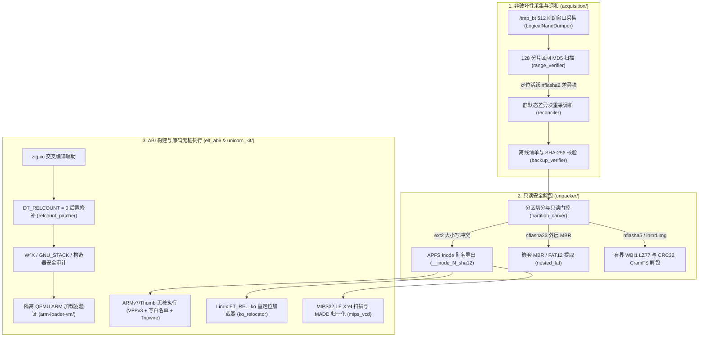

# `sony-fw-inspect` — Sony 固件取证、解包与原码无桩执行公用设施

`sony-fw-inspect` 是面向 **Sony Alpha 7R III (`ILCE-7RM3`)** 及同代多核异构相机平台（ARMv7 Linux + ARMv7/Thumb RTOS + MIPS32 LE VCD 编码协处理器）的可复用离线研究工具链。涵盖**非破坏性逻辑闪存采集与差异调和**、**macOS 大小写冲突安全解包（ext2 / FAT / 嵌套 MBR / `WBI1` / CramFS）**、**Sony `ld-2.11.2.so` `DT_RELCOUNT = 0` ABI 构建器与安全审计器**、**隔离 QEMU ARM 加载器验证沙箱**以及 **Unicorn 原码无桩（Stub-Free）执行套件**。

> [!IMPORTANT]
> **零专有文件与只读取证承诺**
> 1. 本仓库**不包含任何 Sony 专有固件映像、动态库、内核模块（`*.so` / `*.elf` / `*.ko` / `*.bin`）或虚拟机内核（`vmlinuz*` / `initramfs*`）**，亦不内嵌第三方 `fwtool.py`、`e2fsprogs` 或 `ghidra` 代码。
> 2. 所有外部已解包固件统一通过环境变量 `A7R3_FW_ROOT` 在运行时只读引用并强制校验 SHA-256。
> 3. `make test` 中的全部单元测试均基于内存中动态合成的二进制夹具（Synthetic Fixtures），无需相机、无需外部固件即可 100% 离线通过！

---

## 免责声明

> 大家请以学习为目的使用本仓库⚠️⚠️⚠️⚠️，[安全研究法律边界与合规须知](./DISCLAIMER.md#法规与合规参考)
>
> 本仓库的所有内容仅供学习和参考之用，禁止用于商业用途。任何人或组织不得将本仓库的内容用于非法用途或侵犯他人合法权益。本仓库所涉及的固件分析、系统逆向与硬件接口研究技术仅用于个人合法自有设备上的学习与研究，不得用于未经授权侵入或破坏他人设备、绕过技术保护措施、提取或传播第三方专有固件或其他非法行为。对于因使用本仓库内容而引起的任何法律责任、硬件损坏（变砖）、数据丢失或保修失效，本仓库及作者不承担任何责任。使用本仓库的内容即表示您同意本免责声明的所有条款和条件。
>
> 点击查看更为详细的免责声明。[点击跳转](./DISCLAIMER.md)

---

## 系统架构与数据流



---

## 目录结构

```text
sony-fw-inspect/
├── LICENSE                          # MIT 许可证 + 商标与硬件安全免责声明
├── Makefile                         # 一键离线单元测试入口 (make test)
├── pyproject.toml                   # PEP 621 打包配置与 sony-fw-inspect CLI 入口
├── src/sony_fw_inspect/
│   ├── cli.py                       # sony-fw-inspect 统一命令行入口
│   ├── acquisition/
│   │   ├── nand_dumper.py           # /tmp_bt 512 KiB 窗口逻辑闪存采集与断点续传账本
│   │   ├── range_verifier.py        # 128 分片 (64 MiB) 相机端 dd|md5sum 对账
│   │   ├── reconciler.py            # 保留原始镜像前提下仅调和静默态差异分片
│   │   └── backup_verifier.py       # 离线备份清单完整性与路径逃逸防护校验
│   ├── unpacker/
│   │   ├── partition_carver.py      # 分区几何校验、纯 Python / debugfs ext2 大小写安全导出
│   │   ├── root_export.py           # 部分失败根分区 (nflasha7) 补充导出工具
│   │   ├── nested_fat.py            # 嵌套 MBR + FAT12 分区切分与只读文件提取
│   │   └── boot_components.py       # 有界 inflate_bounded() WBI1 解压与 CRC32 CramFS 解包
│   ├── elf_abi/
│   │   ├── relcount_patcher.py      # ld-2.11.2.so DT_RELCOUNT=0 修补器与重定位故障语义模型
│   │   ├── safety_auditor.py        # 零 RWX、非执行栈、零意外 DT_INIT/DT_FINI 审计器
│   │   └── zig_builder.py           # zig cc Cortex-A9 DSO / 静态 ELF 构建封装
│   └── unicorn_kit/
│       ├── arm_stubfree.py          # ARMv7/Thumb 无桩执行器 (自动开启 VFPv3 + 写范围/MMIO 熔断)
│       ├── ko_relocator.py          # ET_REL .ko (R_ARM_ABS32 / R_ARM_CALL / MOVW / MOVT) 加载器
│       └── mips_vcd.py              # MIPS32 LE LUI/ADDIU 引用扫描与旧式 MADD/MADDU 归一化
├── arm-loader-vm/                   # 脱敏的隔离 QEMU ARM 加载器复现沙箱 (纯 C 源码与驱动脚本)
│   ├── init.c / init_phase2.c       # 复现 original-V1 崩溃并验证 fixed-RELCOUNT0 与 O_NOFOLLOW
│   ├── canary.c / inert_im_stub.c   # 自编写无害构造器金丝雀与最小目标进程桩
│   ├── native_preflight_probe.c     # 裸 _start 路由状态与符号探针
│   ├── evidence.py                  # 参数化 ld-2.11.2.so 字节级重定位分析脚本
│   └── build_guest.py / run_guest.py# 动态打包 initramfs 并启动无网络/无磁盘 QEMU 虚拟机
├── ghidra-scripts/                  # Ghidra Headless 聚焦反编译脚本
│   ├── FocusLoader.java             # 针对 ARM.exidx Thumb 函数边界的加载器分析
│   ├── MipsFocused.java             # 注入 $gp=0x802f2920 的 MIPS32 LE VCD 固件反编译
│   └── ArmResetFocused.java         # 针对 av-cam.bin 原始 RTOS 映像的 Thumb 反编译
└── tests/                           # 100% 离线自包含合成夹具单元测试
    ├── test_acquisition_and_backups.py
    ├── test_extract_firmware.py
    ├── test_boot_components.py
    ├── test_elf_abi.py
    └── test_unicorn_kit.py
```

---

## 核心技术亮点

### 1. Sony `/lib/ld-2.11.2.so` `DT_RELCOUNT` 崩溃根因与后置修补 (`elf_abi`)
现代链接器（`lld` / `zig cc`）在使用 `-Wl,-z,now`（立即绑定 `DT_BIND_NOW`）编译 ARM 动态库时，常输出不连续的 `.rel.dyn`（`DT_REL`）与 `.rel.plt`（`DT_JMPREL`）表，同时设置 `DT_RELCOUNT = N`。Sony 相机搭载的旧版 `ld-2.11.2.so`（`0x866e..0x8fc2`）在处理第二个区间（`.rel.plt`）时**重复读取 `DT_RELCOUNT` 且不检查重定位类型**，直接把前 `N` 个 `R_ARM_JUMP_SLOT` 当作 `R_ARM_RELATIVE` 加上基址，导致首次调用外部函数时跳入 `PLT0 -> GOT[2] == 0` 触发 `SIGSEGV` 重启！

`sony-fw-inspect patch-relcount` 与 `audit-elf` 在链接后原地将 `.dynamic` 中的 `DT_RELCOUNT` 置为 `0`，强制动态链接器对两段表均走类型感知分支，同时严格拦截任何 `RWX` 段、可执行栈或非预期全局构造函数（`DT_INIT_ARRAY`）。

### 2. macOS APFS 大小写不敏感文件系统无损导出 (`unpacker`)
相机根分区 `nflasha7`（ext2）包含 10 对大小写仅字母差异的 Linux netfilter 模块（如 `libxt_DSCP.so` 与 `libxt_dscp.so`）。直接解压到 macOS APFS 会发生静默覆盖或报错中断。`partition_carver.py` 内置纯 Python 经典 ext2 块映射读取器（亦支持外部 `debugfs`），自动检测 `NFD + casefold` 冲突并生成可逆的 `__inode_<ino>_<sha12>` 主机别名，完整记录于 `host-path-mapping.json`，且剥离所有导出文件的可执行权限位（`0600`）。

### 3. 原码无桩（Stub-Free）异构执行与旧式 MIPS 指令归一化 (`unicorn_kit`)
- **ARMv7/Thumb (`StubFreeArmRunner`)**：直接映射未修改固件代码，自动开启 Cortex-A9 VFPv3 协处理器（`C1_C0_2` / `FPEXC`），并通过 `UC_HOOK_MEM_WRITE` 写范围白名单与 `UC_HOOK_CODE` OS/日志/MMIO Tripwire 杜绝“伪造桩函数掩盖真实副作用”。
- **Linux `.ko` 重定位 (`ko_relocator`)**：在内存中完成 `ET_REL` 模块的 `.bss` 分配及 `R_ARM_ABS32` / `R_ARM_CALL` / `MOVW` / `MOVT` 重定位，并对未定义内核符号建立精确调用点拦截表。
- **MIPS32 LE VCD (`mips_vcd`)**：将 `vcd_firmware.bin` 中 378 处旧式 `SPECIAL`（`0x00 .. 0x1c/0x1d`）`MADD`/`MADDU` 编码在**仅供静态分析的副本**中归一化为标准 MIPS32 `SPECIAL2`（`0x70000000`），解决 Ghidra 控制流截断问题，同时确保 Unicorn 执行仍使用原始未修改字节。

---

## 快速开始与 CLI 示例

### 1. 运行离线单元测试

```bash
make test
```

### 2. 常用环境变量

| 环境变量 | 用途说明 |
| :--- | :--- |
| `A7R3_FW_ROOT` | 已解包固件根目录（如包含 `filesystems/nflasha7/...` 的目录） |
| `ZIG_CC` | 指定交叉编译器命令（默认自动查找 `zig cc`） |
| `E2FSPROGS_DEBUGFS` | 可选的外部 `debugfs` 可执行文件路径（未设置时自动使用内置纯 Python ext2 读取器） |
| `DEBIAN_ARM_VMLINUZ` | 运行 `arm-loader-vm/run_guest.py` 时使用的通用 ARMv7 Linux 内核路径 |
| `QEMU_ARM` | `qemu-system-arm` 可执行文件路径 |

### 3. CLI 命令示例

```bash
# 1. 离线校验采集目录中的 manifest.json 与全量镜像 SHA-256
sony-fw-inspect verify-backups /path/to/service-acquisition-dir

# 2. 切分经过验证的 nflasha 逻辑镜像并安全导出 ext2 / FAT 文件系统
sony-fw-inspect carve-firmware \
    --image /path/to/nflasha-reconciled.bin \
    --manifest /path/to/manifest.json \
    --geometry /path/to/geometry.json \
    --output /path/to/offline-unpacked

# 3. 有界解压 nflasha5 WBI1 休眠快照与 CRC32 校验解压 initrd.img CramFS
sony-fw-inspect unpack-wbi --input /path/to/nflasha5.bin --output /path/to/wbi-out
sony-fw-inspect unpack-cramfs --input /path/to/initrd.img --output /path/to/cramfs-out

# 4. 为自定义 ARMv7 动态库修补 DT_RELCOUNT = 0 并执行全套 ABI 安全审计
sony-fw-inspect patch-relcount build/libcustom.so -o build/libcustom.patched.so
sony-fw-inspect audit-elf build/libcustom.patched.so

# 5. 生成仅供 Ghidra 分析的 MIPS32 MADD/MADDU 归一化副本并扫描源码路径引用
sony-fw-inspect normalize-mips-madd \
    --input "$A7R3_FW_ROOT/filesystems/nflasha15/export/codec/vcd_firmware.bin" \
    --output /tmp/vcd-analysis-only.bin \
    --report /tmp/vcd-normalization.json
sony-fw-inspect scan-mips-xrefs \
    "$A7R3_FW_ROOT/filesystems/nflasha15/export/codec/vcd_firmware.bin" \
    --filter "venc_param"

# 6. 检查 Linux ET_REL 内核模块符号与重定位表统计
sony-fw-inspect inspect-ko "$A7R3_FW_ROOT/filesystems/nflasha15/export/kmod/dmm.ko"
```

---

## 安全警告

- **绝不挂载不可信或采集自运行态的文件系统至宿主机内核**：请始终使用本工具的用户态只读导出流程（`carve-firmware` / `unpack-cramfs`），严禁对固件分区执行 `mount -o loop` 或 `hdiutil attach`。
- **`normalize-mips-madd` 输出严禁刷机**：输出的二进制文件携带 `deployable=false` 标记，仅用于解决反编译器指令表兼容问题，绝不可写回任何硬件设备。
- **物理备份完整性边界**：`/dev/nflasha*` 仅代表 Linux 内核暴露的逻辑块设备，不包含底层 NAND OOB、BootROM、独立 PMIC 或隐藏分区；所有报告均显式保持 `complete_physical_firmware_backup_verified = false`。
